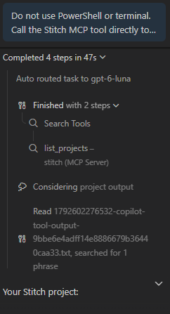

# MCP Integration

## Roles
- Host application: VS Code with GitHub Copilot Chat (Agent mode)
- MCP client: Copilot's built-in MCP client in VS Code
- MCP server: Stitch MCP server

## Tool call
- Tool: `list_projects` on the `stitch` MCP server
- Request: Asked Copilot to list my Stitch projects, without PowerShell or the terminal

## Result
The list_projects tool returned three projects: Asta's Preparation Dashboard, Home UI Design, and Reobank Fintech Design. I used Asta's Preparation Dashboard. Not retrieved: the screens and design files inside the project.

## Screenshot

