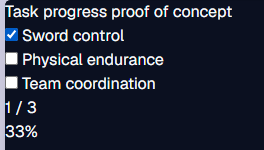

# Proof of Concept: Task Progress

## Question
Can task completion and the progress summary (count and percentage) stay consistent when tasks are completed, undone, and toggled repeatedly?

## Approach
I built a small separate page with three tasks (Sword control, Physical endurance, Team coordination), a checkbox for each, a count, and a percentage. Plain styling only.

The page stores only which tasks are complete. The count and percentage are calculated from that state, so they cannot drift apart. The percentage is rounded to the nearest whole number.

## Test results
| Action | Expected | Actual |
|---|---|---|
| Start with no tasks complete | 0 / 3 and 0% | 0 / 3 and 0% |
| Complete one task | 1 / 3 and 33% | 1 / 3 and 33% |
| Complete a second task | 2 / 3 and 67% | 2 / 3 and 67% |
| Complete all tasks | 3 / 3 and 100% | 3 / 3 and 100% |
| Undo one completed task | 2 / 3 and 67% | 2 / 3 and 67% |
| Toggle the same task repeatedly | Count stays between 0 and 3 | Count stayed between 0 and 3 |

## Screenshot: 

## Issue or observation
The percentage rounds 1/3 to 33% and 2/3 to 67%, which matches the expected values. The page is plain on purpose, because this step only tests the logic. Real styling will come in the MVP.

## Decision
Continue. The logic works, so I will reuse it in the MVP dashboard.