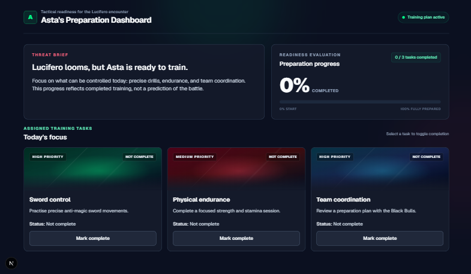
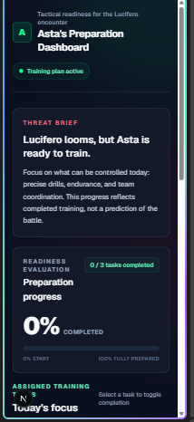
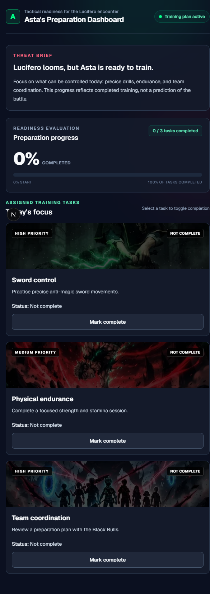
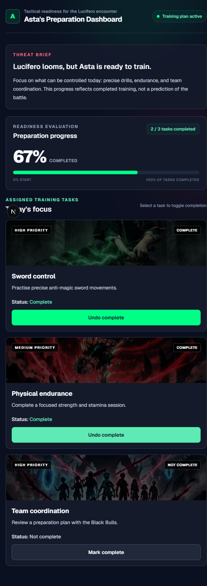
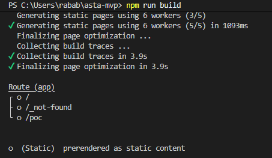

# Review: Asta's Preparation Dashboard

## 1. Scripts and checks

- npm run lint: passed.
- npm run build: passed. It showed a warning that the Windows SWC file is not valid, but Next.js used another way and the build finished.
- I also checked by hand: complete and undo on every task, the count and percentage, the Tab key with a visible outline, refresh, and the layout on mobile (about 360px) and desktop.
- I took screenshots of mobile, desktop, and lint and build.

A successful build does not prove the buttons and the mobile layout work, so I tested them myself.

## 2. Test with one person

- What he did: My friend found the training tasks by himself and completed a task.
- What he said: Each task needs some information about how to complete it, so the user understands what to do. He also said each task should have its own percentage, because the High and Medium tasks both give 33%.
- What confused him: The task description was short and did not explain how to complete the task. He also did not understand why tasks with different priority give the same percentage.
- One improvement I would make: Add a short "how to complete" line to every task. Later I could make the percentage depend on the priority. I did not do it now because my PRD says the MVP has only the three given tasks and the progress is completed tasks divided by 3. I would need to change the PRD first.

## 3. Comparing with my Stitch design

- What was different: In Stitch every task card has an image at the top, but my first version only had a plain colour.
- What I fixed: I asked Copilot to add an image to each card. It must have alt text and a dark layer so the priority and status text stay easy to read. 
- What I did not copy: The long texts from Stitch, because my PRD uses the three given tasks. I kept the priority labels because the checklist needs them.

## 4. My answers

### How did your PRD prevent an unnecessary feature?
The PRD said what is not part of the MVP, so when I wanted or the agent suggested extra things I could say no. I also told the agent in the prompt not to add features outside the PRD. (for example login, saving data, or adding new tasks)

### What did the POC test, and what did it not prove?
The POC tested that complete and undo work and that the count and percentage change correctly. It did not prove that real users want this dashboard, or that it works with real data.

### Why is this MVP useful even though it is small?
It does one clear thing. It shows Asta's three training tasks and how much of the plan is done. Because it is small, I could test it with a real person quickly and get two ideas to improve it.

### What did MCP allow your agent to do, or how did your fallback work?
-  I made the dashboard design in Stitch. The Stitch MCP server was only used to run list_projects, which listed my projects, including Asta's Preparation Dashboard. It did not return the screens or design files. To give the agent the design, I sent my Stitch design to Copilot myself, and Copilot built the layout and style from that. So MCP confirmed the connection, and the design reached the agent through my manual handoff.

### Which AI-generated decision did you correct?
Copilot added image slots to the task cards, but the image files were empty, so no pictures showed and the terminal gave 404 errors. Copilot also told me it could not verify the images. I did not accept that as finished. I saved real images in public/images/ with the exact file names, reloaded the page, and checked that all three cards show their image and the text is still readable.

### Explain the task state and progress calculation.
Every task is either complete or not complete. This is saved in React state in a small Client Component. When I press "Mark complete" or "Undo complete" the state of that task changes. The count is how many tasks are complete, like 2 / 3. The percentage is completed tasks divided by 3, times 100, rounded, so 2 / 3 is 67%. It never goes under 0% or over 100%. All tasks count the same, so High and Medium both give 33%. This was my PRD decision and my friend questioned it. The progress shows plan completion, not a prediction of the battle.

### If agents can generate code, what decisions and checks were still your responsibility?
I decided the scope and wrote the PRD, and I chose the design. I had to check that the app really works: complete and undo, count and percentage, keyboard, mobile and desktop, and refresh.

## 5. Screenshots

### Desktop layout:

### Mobile layout (about 360px):

### Mobile task cards and completion controls (all tasks incomplete)

### Mobile task cards after completing two tasks

### Lint and build results:

